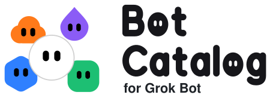

<!-- header:start -->
<p align="center">
  <picture>
    <source media="(prefers-color-scheme: dark)" srcset="assets/byline-dark.svg">
    
  </picture><br>
  <picture>
    <source media="(prefers-color-scheme: dark)" srcset="assets/header-dark.svg">
    
  </picture>
</p>
<!-- header:end -->

<!-- template-note:start -->
> [!NOTE]
> This repository is a template. It is meant to be duplicated, so anyone can build their own shareable, self-updating catalog of Grok Bots. See [Make Your Own Catalog](#make-your-own-catalog).
<!-- template-note:end -->

**Shareable Grok Bots that keep themselves up to date.** Normally, when you add a Grok Bot from a shared link, you get a copy, and the creator's later fixes never reach it. Every Bot here carries a small daily routine that checks this repository for a newer release of itself. When one exists, the bot shows you the changelog, a link to the full diff, and it updates only if you say it is OK. At any time, you can tell the bot to turn automatic checks off or back on.

## Bots

<!-- bots:start -->
<table>
<tr><th width="122"></th><th>Bot</th><th>Description</th><th width="190"></th></tr>
<tr><td width="122" align="center"></td><td><a href="bots/catalog-manager"><b>Catalog Manager</b></a><br><sub>v1.1.6</sub></td><td>Sets up your own Bot Catalog repository and runs it for you. It shares your bots, keeps them up to date, and keeps your catalog current with the template.</td><td width="190" align="center"><a href="https://x.ai/bot/pIcj3rYBnbJhiZCCgVZh4"></a></td></tr>
</table>
<!-- bots:end -->

## Improve a Bot

<!-- improve:start -->
When a bot here gets a fix, everyone who added it is offered the update within a day. So if one gets something wrong, [report it](../../issues/new?template=bot-problem.yml). If you wish a bot did something it doesn't, [suggest it](../../issues/new?template=bot-idea.yml).

You can also make the change yourself. Each bot is a folder of plain text files in [`bots/`](bots), and [CONTRIBUTING.md](CONTRIBUTING.md) explains how to send a pull request.

Only this catalog's owner adds new bots to it. You can [suggest one](../../issues/new?template=bot-idea.yml), but if you have a bot of your own in mind, you might as well [make your own catalog](#make-your-own-catalog) and share it from there.

If you find a security problem, please don't post it in an issue, since issues are public. [SECURITY.md](SECURITY.md#reporting-a-problem) explains how to report it privately.
<!-- improve:end -->

## Make Your Own Catalog

<!-- guide:start -->
### 1. Create Your Catalog

Add the **Catalog Manager** from the table above, then tell it *Set up my catalog*. It connects GitHub, creates your catalog from the template, protects its branches, and remembers which personal details must never be published. Nothing personal reaches GitHub without your yes in chat.

<details><summary>Rather not add the Catalog Manager? Paste this into any Grok Bot instead.</summary>

```text
Set up my own Bot Catalog for Grok Bot on GitHub. Use the GitHub connector. If it isn't connected, ask me to connect GitHub under Connect apps and wait. Use my GitHub account in your browser only for steps the connector can't do.

1. Ask me how I want to be credited on the catalog (my name, X handle, or GitHub username) and which link my name should go to. Ask me which license my bots should use: GPL-3.0, MIT, Apache-2.0, or CC0-1.0. Explain that GPL-3.0 keeps changed copies open, MIT and Apache-2.0 let anyone reuse them with credit, and CC0-1.0 puts them in the public domain. The template's own scripts and docs stay GPL-3.0 either way. Ask me for the personal details that must never be published: my names, email addresses, handles, phone numbers, street address, employer, and anything else I name. Keep that list private, and never write it anywhere except the secret in step 5 if I choose to add it.
2. Create a new repository from the template https://github.com/JaxonWright/bot-catalog-for-grok-bot-template. In the browser, that is "Use this template", then "Create a new repository". Name it `bot-catalog-for-grok-bot`, make it Public, and create it.
3. In the new repository, enable GitHub Actions if it is off, and run the "Set up catalog" workflow on the `master` branch with my credit, link, and license from step 1 as its inputs. Wait until the run finishes with a green check.
4. Protect the repository by adding the two rulesets in its `.github/rulesets/` folder, `protect-master.json` and `protect-release-tags.json`, exactly as written. In the browser, that is Settings, then Rules, then Rulesets, then "New ruleset", then "Import a ruleset", once for each file. Then turn on private vulnerability reporting, which in the browser is Settings, then Security, then "Private vulnerability reporting". Then turn on automatic deletion of merged branches, which in the browser is Settings, then General, then "Automatically delete head branches". Then make workflow runs from outside contributors wait for approval, which in the browser is Settings, then Actions, then General, then "Require approval for all external contributors".
5. Offer to add my private details from step 1 as a repository secret named `PRIVATE_DENYLIST`, so CI also rejects any file that contains one. First tell me who has write access to the repository (currently, for example "only you"), because anyone with write access can read the secret through a workflow on a branch of their own. Suggest leaving it out, since you remove my personal details before anything is pushed and I see every file first. Add it only if I want it, one detail per line. In the browser, that is Settings, then Secrets and variables, then Actions.
6. Tell me the repository link, and that its README's "Maintain This Catalog" section has the next steps for sharing my bots.
```

</details>

Once your catalog exists, its README has a **Maintain This Catalog** section with the next steps.

### 2. Share a Bot

Tell your Catalog Manager *Share my &lt;bot name&gt;*. Say the same thing later to ship an improvement to a bot you already share.

It reads the bot's full definition, strips anything personal, and shows you every file plus what it removed. After your yes, it does the rest. It opens a pull request for the bot. For a new bot, it also creates the public copy that carries the update check and adds its share link, so the bot appears in the README with its **Add Grok Bot** button. Merging the pull request releases the bot. People who already added the bot are offered the update within a day.

<details><summary>Without the Catalog Manager, paste this into the bot you want to share.</summary>

```text
Share yourself through my bot catalog at https://github.com/YOUR-USER/bot-catalog-for-grok-bot. If you are already in it, ship your latest changes instead. Use the GitHub connector. If it isn't connected, ask me to connect GitHub under Connect apps and wait. Use my GitHub account in your browser only for steps the connector can't do.

That repository is public. Anything pushed to it, including branches, commits, and pull requests, is public right away and stays in its history even if it is deleted later. So nothing goes to GitHub until I approve it here.

1. Read `CONTRIBUTING.md` in the repository for the file format, and check whether `bots/` already has you.
2. Draft your files for `bots/<slug>/` in this chat: `bot.toml`, `instructions.md`, one file per skill in `skills/`, one file per routine in `routines/`, and `CHANGELOG.md`. Use a short lowercase slug. For the avatar, use the shape and color of your built-in default mark in Grok Bot, by their Grok Bot names. Leave out the "Check for bot updates" skill and routine if you have them, because the catalog adds those.
3. Remove everything personal: names, email addresses, accounts, handles, phone numbers, addresses, links to private files or tools, keys, and anything you know only from your memory or our conversations. Where a skill needs one of those, have it ask the user and remember the answer instead.
4. If you are already in the catalog, bump `version` in `bot.toml`: patch for wording fixes, minor for new skills or routines, major for changes to what you do on your own. Add a changelog section for the new version that says what changes for the people using you.
5. Show me every file in full, then a separate list of everything you removed. Wait until I say it looks good. My yes covers the rest of these steps.
6. Create a branch off `master`, commit the approved files exactly as approved, and open a pull request into `master`. Keep the commit message and pull request description to what changes for users, and never mention what you removed. Wait for the Build workflow to add the generated files and for the check to finish.
7. If you were not in the catalog before, the check fails until you have a share link, so publish yourself. Create a new Bot and have it fetch https://raw.githubusercontent.com/YOUR-USER/bot-catalog-for-grok-bot/<your branch>/dist/<slug>.md and set itself up exactly as that file's "How to apply" section says, with your name. It sets its avatar with Grok Bot's built-in default mark, using the shape and color in `bot.toml`, and must not generate or upload a custom picture; if one is installed, it clears it. In that new Bot, open Share, choose "Create template", pick "Public link", and set the template's description to the `summary` in `bot.toml`, word for word. That description is what people see on the share link, so never put your instructions there. Then copy the link. Then set `share_url` in `bots/<slug>/bot.toml` to the link on the same branch, and change nothing else.
8. Merge the pull request once its check passes. That releases you.
9. Tell me it's live. If you were new, give me your share link.

If any check fails, show me the error and how you would fix it, and wait.
```

</details>

Every day, your Catalog Manager checks for new issues and pull requests and tells you about them. Other people can suggest changes to your bots, but only you add bots to your catalog.

### 3. Keep Up With the Template

The template's workflows, scripts, and update check improve over time, and a catalog doesn't get those changes on its own. Tell your Catalog Manager *Update my catalog from the template*. It also checks every week and asks before it changes anything.

Prefer to work by hand? See [docs/make-your-own.md](docs/make-your-own.md). For diagrams of how the pieces fit together, see [docs/how-it-works.md](docs/how-it-works.md).
<!-- guide:end -->

<!-- maintain:start -->
<!-- maintain:end -->

## Disclaimer

This is an independent community project. It is not an official Grok Bot project, and it is not affiliated with, endorsed by, or sponsored by SpaceXSI, X, Cursor, or Grok in any way. Grok and Grok Bot are trademarks of their respective owners and are used here only to describe what these bots work with.

## License

<!-- license:start -->
The bots, scripts, and docs in this repo are licensed under the [GNU General Public License v3.0](LICENSE). You can use, change, and share them. If you share a changed version, it must stay under the GPL-3.0 and include its source.
<!-- license:end -->
