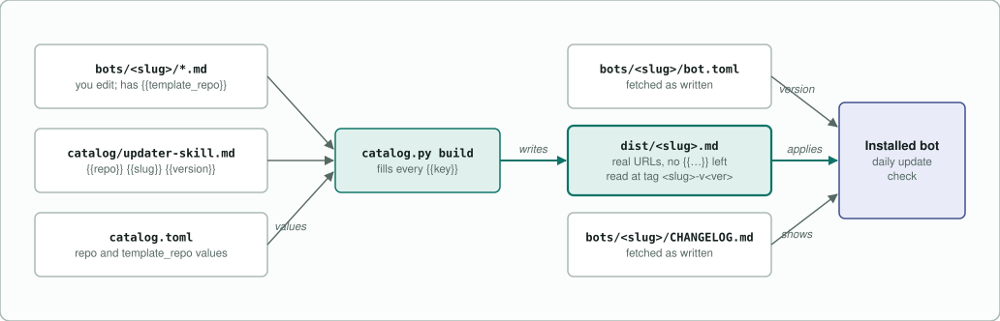
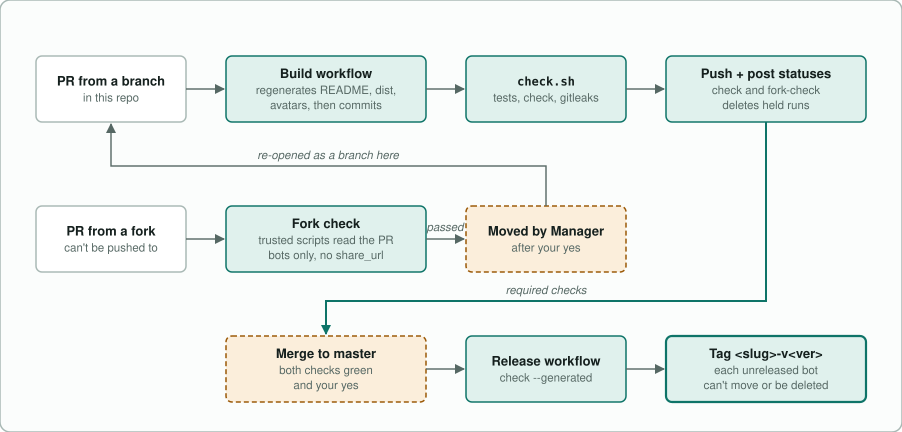
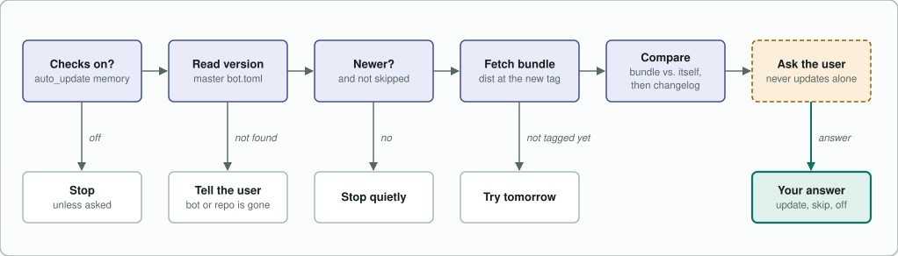
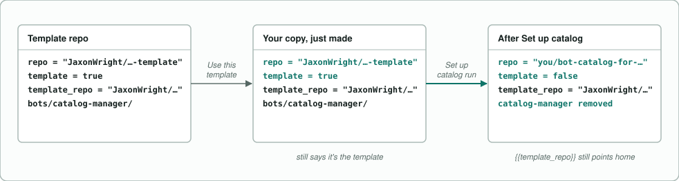
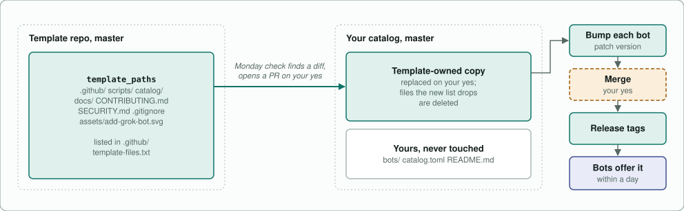
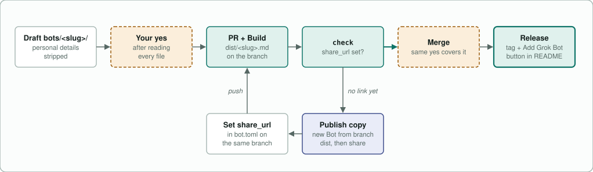

# How the catalog works

This page shows how a bot gets from the files in `bots/` into someone's Grok Bot, and how it stays up to date after that. To do these steps yourself, see [Make your own catalog by hand](make-your-own.md).

Every diagram uses this key. Teal arrows mark the main path.

<picture>
  <source media="(prefers-color-scheme: dark)" srcset="diagrams/legend-dark.svg">
  
</picture>

To change a diagram, edit `scripts/diagrams.py` and run `python scripts/diagrams.py`.

## People install the built bundle, not the source files

You edit the files in `bots/<slug>/`. People install `dist/<slug>.md`, which `scripts/catalog.py build` generates from those files. The build replaces each `{{key}}` with a value from `catalog.toml`, so the placeholders in `bots/` and `catalog/` never reach an installed bot.

<picture>
  <source media="(prefers-color-scheme: dark)" srcset="diagrams/placeholders-dark.svg">
  
</picture>

The build fills `repo`, `template_repo`, `slug`, `name`, and `version`. It leaves any other `{{key}}` as written, so a misspelled key ships as literal text.

## Every change reaches master through a pull request

`master` requires two checks, `check` and `fork-check`. A branch in this repository gets both from the Build workflow. A fork's branch can't be pushed to, so the Catalog Manager moves a fork's pull request into a branch here before it can merge.

<picture>
  <source media="(prefers-color-scheme: dark)" srcset="diagrams/pull-requests-dark.svg">
  
</picture>

GitHub holds the workflow runs that a workflow's own push starts. That's why Build runs `check.sh` on its commit itself, posts both statuses, and deletes the held runs. CI also runs `check.sh` on every pull request and every push to `master`. Fork check never gets the `PRIVATE_DENYLIST` secret. A release tag can't be moved or deleted, so Release runs the check again before it tags anything.

## Installed bots check for updates once a day

The build adds a "Check for bot updates" skill and a daily routine to every bot. The check says nothing unless it has an update to offer or finds that the bot or the repository is gone.

<picture>
  <source media="(prefers-color-scheme: dark)" srcset="diagrams/update-check-dark.svg">
  
</picture>

The bot works out what would change by comparing the bundle with its own setup, because whoever wrote the changelog may have left something out. It still shows the changelog, and it points out anything the bundle changes that the changelog doesn't mention.

## Set up catalog turns a copy of the template into a catalog

**Use this template** makes an exact copy, and the copy's `catalog.toml` still says it is the template. Until the Set up catalog workflow runs, Release tags nothing in it.

<picture>
  <source media="(prefers-color-scheme: dark)" srcset="diagrams/setup-dark.svg">
  
</picture>

Set up catalog refuses to run in the template itself. It credits you, sets the bots' license, removes every bot marked `template_only`, and rebuilds the README and bundles. After that, `{{repo}}` fills in as your repository, and `{{template_repo}}` still names the template, which is where template updates come from.

## Template updates arrive as a pull request

The template owns the paths listed in `template_paths` in `catalog.toml`. Every Monday, the Catalog Manager compares those paths with your `master` and offers a pull request if they differ.

<picture>
  <source media="(prefers-color-scheme: dark)" srcset="diagrams/template-updates-dark.svg">
  
</picture>

`.github/template-files.txt` lists the files the template owned at the last update. The update deletes only the files on that old list that the new list drops, so it never deletes a file you added. A change to `catalog/` or `scripts/catalog.py` changes every bundle, so the check asks for a patch bump on each released bot. That bump is how installed bots get the new update check.

## A new bot needs its share link before it can merge

A new bot's check fails until `bot.toml` has a `share_url`. The link must open a Grok Bot set up from the branch's own bundle, so you publish the bot from inside the pull request.

<picture>
  <source media="(prefers-color-scheme: dark)" srcset="diagrams/sharing-dark.svg">
  
</picture>

Only the Bot you create in this step can later use **Share**, then **Update template**. If you delete it, its public link stays on its current version for good.
